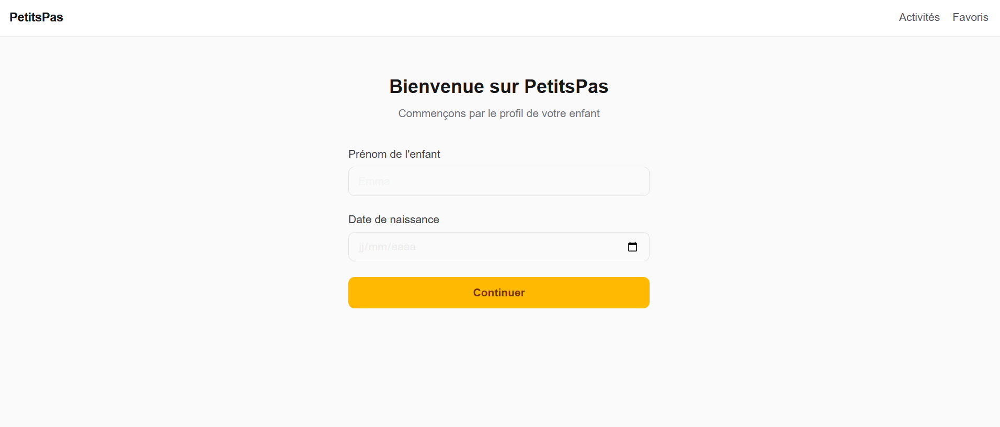
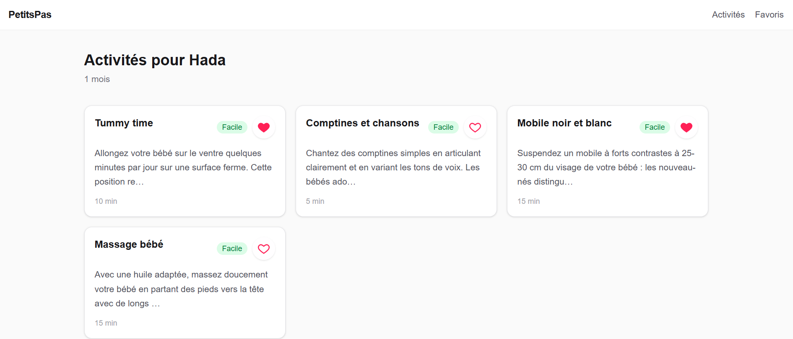

# PetitsPas 🌱

**PetitsPas** is a web app that suggests activities precisely matched to a child's age
in months, with AI-personalized tips powered by the Claude API. It was built both as a
portfolio project and as the foundation for a future commercial product.

**Live demo:** [petitpas-rho.vercel.app](https://petitpas-rho.vercel.app/)

---

## Demo




---

## Key Features

- **Onboarding by exact age** — parents enter their child's birth date once; the app
  derives their age in months and uses it everywhere activities are filtered.
- **Age-appropriate activity feed** — activities are filtered server-side by
  `ageMin`/`ageMax`, with difficulty levels (`facile` / `moyen` / `avance`).
- **AI-personalized suggestions** — a "get a suggestion" action calls the Claude API
  to generate concrete, age-adapted tips for a given activity (with a mock mode for
  local development without an API key).
- **Favorites** — save activities for quick access later, persisted per user.
- **Installable PWA** — manifest + icons so the app can be added to a phone's home
  screen like a native app.
- **Animated transitions** — page and state transitions handled with Framer Motion
  (e.g. onboarding → activities).
- **Mobile-first responsive UI** — bottom tab navigation on mobile, top nav on desktop.

---

## Tech Stack & Rationale

| Choice | Why |
|---|---|
| **Next.js (App Router)** | Server Components by default keep data-fetching close to the source and reduce client JS; file-based routing (`not-found.tsx`, route groups) keeps the routing layer thin. |
| **TypeScript (strict)** | Catches shape mismatches (e.g. Supabase snake_case rows vs. app camelCase models) at compile time instead of in production. |
| **Supabase (Auth + PostgreSQL)** | Managed Postgres with built-in auth, avoiding the cost of running/maintaining a separate backend for a portfolio-scale project. |
| **Zustand** | Minimal global state (current child, favorites) without Redux-level boilerplate; selectors keep re-renders scoped to what actually changed. |
| **Claude API** | Generates natural-language, context-aware suggestions per activity and child age — the core differentiator of the app. |
| **Tailwind CSS v4** | Utility-first styling keeps components self-contained and avoids a growing, hard-to-track CSS file. |
| **Framer Motion** | Declarative enter/exit animations for route and state transitions without hand-rolled CSS transitions. |
| **Jest + Testing Library** | Unit tests target business logic (hooks, services, stores) — the parts most likely to break silently. |

**Architecture principle:** the codebase follows a **feature-based structure** with a
clear separation of concerns — UI components only render and call hooks, hooks hold
business logic, services handle data access (Supabase/API calls). This keeps each
feature testable and independent, in line with SOLID's single-responsibility idea
applied pragmatically rather than dogmatically.

---

## Project Structure

```
src/
├── app/                    # Next.js routing only — no business logic here
│   ├── (app)/              # Route group: main app shell (nav, layout)
│   │   ├── page.tsx         # Home (onboarding or activities list)
│   │   ├── activites/[id]/  # Activity detail page
│   │   └── favoris/         # Favorites page
│   ├── api/suggestions/     # API route: Claude suggestion endpoint
│   ├── layout.tsx           # Root layout (fonts, global metadata)
│   └── not-found.tsx        # Global 404 page
│
├── features/                # One folder per feature, self-contained
│   ├── activites/            # Activities: types, services, hooks, components
│   ├── enfant/                # Child profile & onboarding
│   ├── favoris/                # Favorites
│   └── ia/                      # AI suggestion feature (Claude API)
│       ├── components/        # UI only
│       ├── hooks/              # Business logic
│       ├── services/           # API / DB calls
│       └── types.ts            # Feature-scoped types
│
├── shared/                   # Reusable across features
│   ├── components/            # BottomTabBar, PageTransition...
│   └── lib/                    # Supabase client, DB seed script
│
└── store/                    # Global Zustand stores (child, favorites)
```

---

## Getting Started

### Prerequisites

- Node.js 22
- A [Supabase](https://supabase.com) project (free tier is enough)
- An [Anthropic API key](https://console.anthropic.com) (optional — the app runs in
  mock mode without one)

### Installation

```bash
git clone <repo-url>
cd petitspas
npm install
```

### Environment variables

Create a `.env.local` file at the project root:

```bash
NEXT_PUBLIC_SUPABASE_URL=your-supabase-project-url
NEXT_PUBLIC_SUPABASE_ANON_KEY=your-supabase-anon-key
SUPABASE_SERVICE_ROLE_KEY=your-supabase-service-role-key   # used by the DB seed script only
ANTHROPIC_API_KEY=your-anthropic-api-key                   # optional
MOCK_AI=true                                                # set to skip real Claude calls
```

### Database

Create the following tables in your Supabase project:

| Table | Columns |
|---|---|
| `profiles` | `id` (uuid, FK → `auth.users`) |
| `children` | `id`, `user_id`, `name`, `birth_date` |
| `activities` | `id`, `title`, `description`, `age_min`, `age_max`, `duration`, `materials[]`, `benefits[]`, `difficulty`, `is_premium` |
| `favorites` | `id`, `user_id`, `activity_id` |

Then seed sample activities:

```bash
npx tsx src/shared/lib/seed.ts
```

### Run locally

```bash
npm run dev
```

Open [http://localhost:3000](http://localhost:3000).

### Tests

```bash
npm test          # run once
npm run test:watch
```

